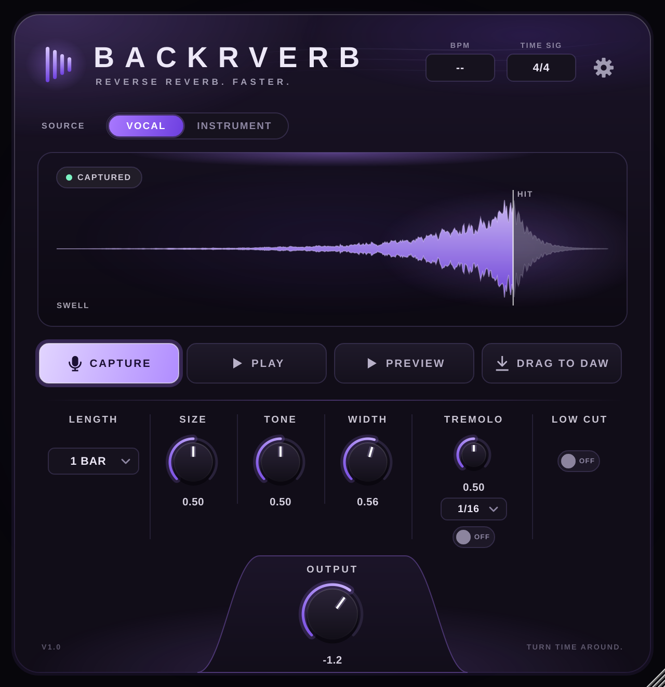

# BACKRVERB

**Reverse reverb. Faster.** Plugin VST3 para Windows (probado para FL Studio) que crea swells de reverb inversa sincronizados al tempo en segundos: capturas un sonido, BACKRVERB genera la reverb invertida que sube hasta el golpe, y la arrastras directo al playlist.



## Descarga

1. Ve a **Releases → latest** (o a la pestaña **Actions** → último build → artefacto `BACKRVERB-Windows-VST3`).
2. Descarga `BACKRVERB-Windows-VST3.zip` y descomprímelo.
3. Copia la carpeta **`BACKRVERB.vst3`** a `C:\Program Files\Common Files\VST3\`.
4. En FL Studio: *Options → Manage plugins → Find installed plugins* y busca **BACKRVERB**.

No necesita instalar Visual C++ Redistributable (runtime estático).

## Cómo se usa en FL Studio

1. Pon BACKRVERB en el **Mixer** en el canal de la voz/instrumento (o en el Master).
2. Pulsa **CAPTURE** (queda en *ARMED*) y reproduce el sonido: graba en cuanto detecta señal y se detiene solo tras ~1.2 s de silencio (o pulsa **STOP**).
3. Ajusta **LENGTH** (1/4, 1/2, 1, 2 o 4 compases según el BPM y compás del proyecto), **SIZE**, **TONE**, **WIDTH**, **TREMOLO** y **LOW CUT**. El render se actualiza al momento.
4. **PLAY** reproduce el swell; **PREVIEW** reproduce el swell seguido del sonido original.
5. **DRAG TO DAW**: arrastra el botón al **Playlist** de FL. El final del clip es el golpe: colócalo de modo que termine justo donde empieza tu sonido (el clip dura exactamente LENGTH, así que si mides 1 compás, empieza un compás antes).
   Si solo haces clic, guarda el WAV y abre la carpeta. Los archivos quedan en `Documentos\BACKRVERB Exports`.

La captura se guarda dentro del proyecto de FL: al reabrirlo sigue ahí.

## Controles

| Control | Función |
|---|---|
| SOURCE | *Vocal*: más brillante, con más pre-delay y corte de graves; *Instrument*: más denso y oscuro |
| LENGTH | Duración del swell sincronizada al tempo del host (1/4 BAR – 4 BARS) |
| SIZE | Tamaño de la sala y tiempo de decaimiento (siempre proporcional a LENGTH para que el swell lo llene) |
| TONE | Oscuro ↔ brillante (amortiguación + filtro) |
| WIDTH | 0 = mono, 0.5 = natural, 1 = extra ancho (M/S) |
| TREMOLO | Profundidad del trémolo sincronizado (1/4 … 1/32, tresillos), en fase con el golpe; ON/OFF |
| LOW CUT | Paso-altos (~220–280 Hz) para que el swell no ensucie los graves |
| OUTPUT | Nivel de salida (aplica a la reproducción y a lo exportado) |
| ⚙ | Normalizar render (-1 dBFS), auto-stop de la captura, abrir carpeta de exportes, borrar captura |

El audio de entrada pasa sin cambios; la reproducción de PLAY/PREVIEW se suma a la salida.

## Cómo funciona

1. Recorta el silencio de la captura y la invierte.
2. La pasa por una reverb FDN de 8 líneas (difusión, modulación, amortiguación) y toma solo la cola húmeda.
3. Invierte esa cola: el resultado crece y termina exactamente en el ataque del sonido original.
4. Aplica tono, low cut, ancho estéreo, trémolo sincronizado, fade-in suave y normaliza.

## Compilar

Lo compila GitHub Actions en cada push (`.github/workflows/build-windows.yml`). En local (Windows, Visual Studio 2022 + CMake):

```
cmake -S . -B build -A x64
cmake --build build --config Release
```

Prueba sin interfaz: `-DBRV_BUILD_TESTS=ON` y ejecuta `brv_host_test`.

Construido con [JUCE 8](https://juce.com).
